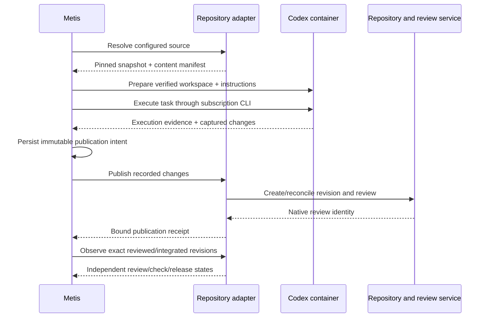

# Repository adapters: source, workspace, change, review

## Purpose and implementation status

Metis owns task capture, dependencies, execution attempts, capacity decisions,
and Codex runtime/session tracking. A repository adapter supplies source context
and publishes reviewable outputs. It does not launch Codex or own task state.

The common unit is a **versioned source workspace plus a reviewable change**.
GitHub and Cloudflare Artifacts are implementations of the same contract.
Cabinitron is an Artifacts-hosted project with its own review workflow and
validation rules, rather than a third repository transport.

This PR adds a version-1 data contract and conformance tests in
`src/repository-adapters/contract.mjs`. It does not register production adapters,
add task fields/migrations, materialize repositories in containers, publish
reviews, or change the existing GitHub-backed dispatcher. The lifecycle below
is the intended integration design. A future implementation must wire the
validators into each boundary; defining an adapter alone does not enforce them.

## Responsibilities

| Operation | Common responsibility | GitHub implementation | Artifacts implementation |
|---|---|---|---|
| Resolve | Authorize a configured repository and pin an immutable source revision | Resolve branch/ref to commit | Resolve source ref to native revision |
| Prepare | Materialize the verified snapshot and applicable instructions in an isolated workspace | Checkout/export pinned repository source | Checkout/export pinned Artifacts source |
| Collect | Compare final workspace against its pinned base, verify content, capture a bounded change manifest and evidence | May use Git internally | May use Git internally, without assuming GitHub |
| Publish | Idempotently create a review for the recorded change and return native identity/permalink | Push an attempt branch and open a PR | Submit source revision and register an Artifacts/project review |
| Observe | Report review, checks, integration and deployment evidence for exact revisions | PR, checks, merge SHA, deployment | Review service, validation, integrated revision, release evidence |

Artifacts review publication is project-specific. The inspected Cabinitron
client (`scripts/submit-diff.mjs` and `scripts/review-client.mjs` in its local
Artifacts checkout) pushes a source revision then registers a review. Its review
link uses a query-based diff ID. That local implementation informed this mapping;
it is not a claim about a universal Cloudflare review API or current production
configuration. The adapter must use the project's supported service interface
and preserve its human approval and release policy.

## Lifecycle interface

An implementation exports only:

```js
const adapter = defineRepositoryAdapter({
  id: 'github', // or 'artifacts'
  version: 'immutable-implementation-version',
  resolve, prepare, collect, publish, observe,
});
```

The proposed calls are:

```text
resolve({source}) -> snapshot
prepare({snapshot, workspaceHandle}) -> prepared workspace handle
collect({snapshot, workspaceHandle}) -> {changeSet, evidence}
publish({intent}) -> publication receipt
observe({publication}) -> observation
```

`resolve` is control-plane work; `prepare` and `collect` run in the trusted runtime
supervisor around Codex. `publish` and `observe` run outside the model session.
The workspace handle is provisioned by the runtime and resolved locally; it is
not an arbitrary host path from the task. Credentials come from trusted adapter
configuration/closures, never from these serialized records. Reading these
records does not authorize network access or content retrieval.

There is deliberately no `launchCodex`, `approve`, `merge`, or `deploy` method.
Review publication can be automated without a manual Codex UI step. Approval,
integration, and deployment retain their separate policy/authorization paths.



## Common records

A source identifies the configured adapter, repository, and requested ref:

```json
{"adapter":"artifacts","repository":"example/project","ref":"main"}
```

A resolved snapshot includes `version`, `source`, an immutable `adapterVersion`,
opaque provider `revision`, hashed `content` reference, and an `instructions`
manifest of applicable instruction-file paths and hashes. `revision` is not
required to be a Git SHA. A mutable ref such as `main` must be resolved once;
retries use that snapshot, not whatever `main` points to later. Provider
implementations must verify that the returned revision is immutable.

The snapshot content reference identifies a verified source bundle/manifest in
a configured content store. It is not a signed download URL or credential. The
contract does not require R2 or any particular storage system. The production
content transport, storage limits, and retention policy are still to be chosen;
existing 48 KB execution receipts are not suitable for arbitrary repositories.

A change set contains `version`, `source`, `baseRevision`, and file changes:

```json
{
  "path":"src/example.mjs",
  "before":{"sha256":"<old-content-sha256>","mode":"100644"},
  "after":{"sha256":"<new-content-sha256>","mode":"100644","contentRef":"blob:opaque-id"}
}
```

`before: null` adds a file; `after: null` deletes it. Content references support
text and binary bytes. Renames are represented as delete/add in v1. Regular and
executable file modes are supported; symlinks and submodules are rejected until
explicit support exists. Unsafe paths, `.git` metadata, duplicate/case-colliding
paths, empty changes, and unchanged files are rejected. Limits are currently
100 instruction files, 1,000 changes, and 50 evidence references per intent.

Validation of the manifest does not verify the actual bytes. The supervisor
must compare the base hashes/modes against the pinned snapshot, compute hashes
of captured outputs, validate evidence, and verify the content-store references
belong to the authorized task. Safe extraction must prevent link/traversal
escapes and writes through symlinked parents. Local Git hooks/configuration,
submodules, and remote helpers must not execute as a side effect of checkout or
publication. Provider code must use argument arrays and validate refs rather
than interpolating task values into shell commands.

The canonical SHA-256 of the sorted change manifest binds output identity.
`publicationIntent()` freezes a copy of the snapshot, changes, review title,
description, evidence, task ID, and attempt ID. Its `metis-review-…` key binds all
of those fields, including adapter implementation version. File/JSON-key
ordering does not change that identity; different attempts or review metadata
do. Intent records and content manifests must contain no usable credentials.

The publication receipt echoes adapter/repository, pinned base, change digest,
and idempotency key. It also carries the native review ID, HTTPS permalink, and
exact submitted revision. Validate it against the recorded intent and the
adapter's configured review origins. Query-based review IDs are supported;
credential-bearing or signed access links must never be retained as permalinks.
The helper rejects userinfo and common credential query names; provider-specific
URL construction must exclude any other secret-bearing parameters.

## Publication reliability and durable ownership

D1 should eventually retain, per attempt/source binding: the snapshot,
immutable publication intent/key, phase, native publication receipt, and latest
observation. Large source/output bytes belong in the configured content
transport. These persistence records are proposed here, not a new migration.

Persist intent **before** provider writes. On timeout or restart, reconcile the
same key against both source revision and review before attempting creation.
Branch names or review markers should carry a stable key when supported.
GitHub may require reconciliation between branch creation and PR creation;
Artifacts may require it between revision upload and review registration.
If a provider cannot establish whether a write happened, record publication as
blocked/unknown and require reconciliation. Never claim exactly-once external
writes just because a key exists. Do not rerun successful Codex work merely
because publishing or polling failed.

A changed base cannot silently rebase the original output. Return a distinct
stale-base blocker and arrange a new explicitly recorded attempt/snapshot.
Updating an existing review must compare its expected head and obey the review
service's terminal-state policy. New output cannot inherit old approvals or
successful checks. No provider write is authorized by a model-emitted URL,
repository name, or `data` field alone.

## Independent state dimensions

Track execution and publication separately:

- **Execution:** queued, running, completed, blocked, failed (existing attempt).
- **Publication:** prepared, publishing, published, blocked/unknown (future ledger).
- **Review:** open, closed, integrated, unknown; approval is a separate value.
- **Checks:** pending, passed, failed, unknown, bound to the submitted revision.
- **Integration:** not integrated, integrated, unknown, with the resulting revision.
- **Deployment:** not started, pending, succeeded, failed, unknown, with its revision.

A successful CLI turn is not a published review. A published review is not
approved, approval is not integration, and integration is not deployment.
Passing checks must cover the submitted revision; a successful deployment must
cover the exact integrated revision under Metis's current release policy.
Unknown/inaccessible evidence stays unknown. The contract validator rejects
stale passing checks and mismatched successful deployment evidence.

Task dependency policy can later specify `execution_completed`,
`review_published`, `integrated`, or `deployed`; it must not silently change the
current task UI's execution-completed semantics. All records retain
`task ID -> attempt ID -> source revision -> review ID -> integrated revision`
and the separate Codex thread/session association.

## First implementation sequence

1. Add configured source bindings to draft tasks and persist the resolved
   snapshot per attempt. Begin with one writable source per task; additional
   read-only context sources can use the same contract later.
2. Implement GitHub resolve/prepare/collect against the existing cloud runtime;
   capture general repository diffs outside the current fixed proof artifacts.
3. Add the durable publication ledger and GitHub branch/PR reconciliation.
4. Implement the Artifacts transport plus the Cabinitron review-service mapping,
   preserving source, validation, media, and approval requirements.
5. Expose review and exact-revision check/release links/status in the task UI.

Conformance tests use synthetic GitHub and Artifacts records and make no
network calls. Each real adapter still needs provider contract tests, credential
scoping checks, timeout/crash reconciliation tests, and one verified live task
before it can be called operational.
