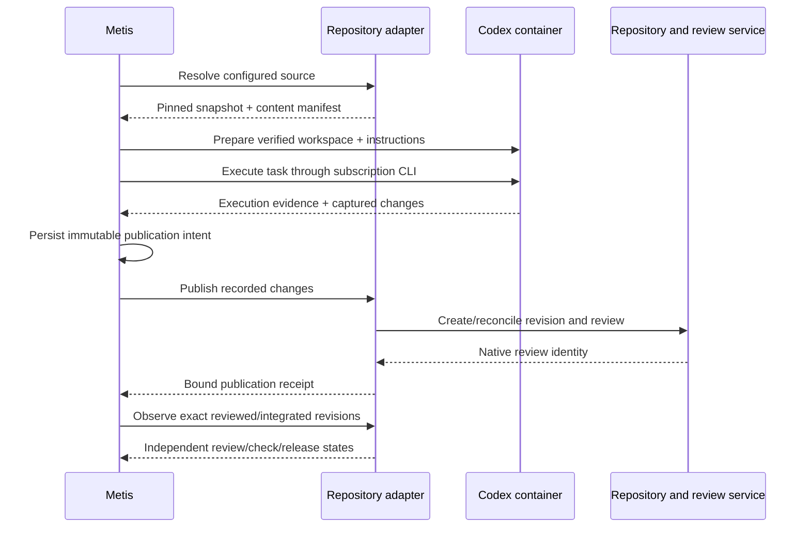

# Repository adapters: source, workspace, change, review

## Purpose and implementation status

Metis owns task capture, dependencies, execution attempts, capacity decisions,
and Codex runtime/session tracking. A repository adapter supplies source context
and publishes reviewable outputs. It does not launch Codex or own task state.

The common unit is a **versioned source workspace plus a reviewable change**.
GitHub and Cloudflare Artifacts are implementations of the same contract.
Cabinitron is an Artifacts-hosted project with its own review workflow and
validation rules, rather than a third repository transport.

The version-1 contract now has Git-backed GitHub/Artifacts implementations and
a cloud task integration. See [operating repository-backed cloud tasks](repository-adapters-operations.md)
for current capabilities, configuration, tests and blockers. Initial publication,
GitHub rework, D1 content/recovery records and configured media transports are
implemented. Artifacts rework is deliberately blocked until the project's
review API provides a conditional previous-review-version update. Production
operation still requires configured credentials and an authorized live test.

## Responsibilities

| Operation | Common responsibility | GitHub implementation | Artifacts implementation |
|---|---|---|---|
| Resolve | Authorize a configured repository and pin an immutable source revision | Resolve branch/ref to commit | Resolve source ref to native revision |
| Prepare | Materialize the verified snapshot and applicable instructions in an isolated workspace | Checkout/export pinned repository source | Checkout/export pinned Artifacts source |
| Collect | Compare final workspace against its pinned base, verify content, capture a bounded change manifest and evidence | May use Git internally | May use Git internally, without assuming GitHub |
| Publish | Idempotently create a review for the recorded change and return native identity/permalink | Push an attempt branch and open a PR | Submit source revision and register an Artifacts/project review |
| Read change | Retrieve the submitted snapshot, review feedback and concurrency guard | Read PR head, feedback, state and expected branch head | Read review source, feedback and updateability/token |
| Prepare rework | Combine prior submitted work with a freshly resolved target base | Prepare PR changes against the current target | Prepare reviewed diff against current Artifacts source |
| Update | Replace the submitted revision with a guarded, recorded revision | Update the same PR branch using expected-head protection | Update the same review if its state permits it |
| Observe | Report review, checks, integration and deployment evidence for exact revisions | PR, checks, merge SHA, deployment | Review service, validation, integrated revision, release evidence |

Artifacts review publication is project-specific. The inspected Cabinitron
client (`scripts/submit-diff.mjs` and `scripts/review-client.mjs` in its local
Artifacts checkout) pushes a source revision then registers a review. Its review
link uses a query-based diff ID. That local implementation informed this mapping;
it is not a claim about a universal Cloudflare review API or current production
configuration. The adapter must use the project's supported service interface
and preserve its human approval and release policy.

## Lifecycle interface

An implementation exports only:

```js
const adapter = defineRepositoryAdapter({
  id: 'github', // or 'artifacts'
  version: 'immutable-implementation-version',
  resolve, prepare, collect, publish, readChange, prepareRework, update, observe,
});
```

The proposed calls are:

```text
resolve({source}) -> snapshot
prepare({snapshot, workspaceHandle}) -> prepared workspace handle
collect({snapshot, workspaceHandle}) -> {changeSet, evidence}
publish({intent}) -> initial publication receipt
readChange({publication}) -> submitted change + feedback + update guard
prepareRework({snapshot, submittedChange, reason, workspaceHandle}) -> rework workspace
update({intent}) -> new publication receipt for the same change/review
observe({publication}) -> observation
```

`resolve` and `readChange` are control-plane work; `prepare`, `prepareRework`,
and `collect` run in the trusted runtime supervisor around Codex. `publish`,
`update`, and `observe` run outside the model session.
The workspace handle is provisioned by the runtime and resolved locally; it is
not an arbitrary host path from the task. Credentials come from trusted adapter
configuration/closures, never from these serialized records. Reading these
records does not authorize network access or content retrieval.

There is deliberately no `launchCodex`, `approve`, `merge`, or `deploy` method.
Review publication can be automated without a manual Codex UI step. Approval,
integration, and deployment retain their separate policy/authorization paths.



## Common records

A source identifies the configured adapter, repository, and requested ref:

```json
{"adapter":"artifacts","repository":"example/project","ref":"main"}
```

A resolved snapshot includes `version`, `source`, an immutable `adapterVersion`,
opaque provider `revision`, hashed `content` reference, and an `instructions`
manifest of applicable instruction-file paths and hashes. `revision` is not
required to be a Git SHA. A mutable ref such as `main` must be resolved once;
retries use that snapshot, not whatever `main` points to later. Provider
implementations must verify that the returned revision is immutable.

The snapshot content reference identifies a verified source bundle/manifest in
a configured content store. It is not a signed download URL or credential. The
contract does not require R2 or any particular storage system. The production
content transport, storage limits, and retention policy are still to be chosen;
existing 48 KB execution receipts are not suitable for arbitrary repositories.

A change set contains `version`, `source`, `baseRevision`, and file changes:

```json
{
  "path":"src/example.mjs",
  "before":{"sha256":"<old-content-sha256>","mode":"100644"},
  "after":{"sha256":"<new-content-sha256>","mode":"100644","contentRef":"blob:opaque-id"}
}
```

`before: null` adds a file; `after: null` deletes it. Content references support
text and binary bytes. Renames are represented as delete/add in v1. Regular and
executable file modes are supported; symlinks and submodules are rejected until
explicit support exists. Unsafe paths, `.git` metadata, duplicate/case-colliding
paths, empty changes, and unchanged files are rejected. Limits are currently
100 instruction files, 1,000 changes, and 50 evidence references per intent.

Validation of the manifest does not verify the actual bytes. The supervisor
must compare the base hashes/modes against the pinned snapshot, compute hashes
of captured outputs, validate evidence, and verify the content-store references
belong to the authorized task. Safe extraction must prevent link/traversal
escapes and writes through symlinked parents. Local Git hooks/configuration,
submodules, and remote helpers must not execute as a side effect of checkout or
publication. Provider code must use argument arrays and validate refs rather
than interpolating task values into shell commands.

The canonical SHA-256 of the sorted change manifest binds output identity.
`publicationIntent()` freezes a copy of the snapshot, changes, review title,
description, evidence, task ID, attempt ID, and stable change ID. Rework also
binds its previous publication, submitted snapshot, feedback and concurrency
guard. Its `metis-review-…` key binds all
of those fields, including adapter implementation version. File/JSON-key
ordering does not change that identity; different attempts or review metadata
do. Intent records and content manifests must contain no usable credentials.

The publication receipt echoes adapter/repository, target ref, pinned base,
change digest, task/attempt IDs, stable change ID, operation (`create` or
`update`), parent publication key, and idempotency key. It also carries the native review ID, HTTPS permalink, and
exact submitted revision. Validate it against the recorded intent and the
adapter's configured review origins. Query-based review IDs are supported;
credential-bearing or signed access links must never be retained as permalinks.
The helper rejects userinfo and common credential query names; provider-specific
URL construction must exclude any other secret-bearing parameters.

## Review bodies and before/after UI evidence

Review descriptions have an explicit canonical format:
`descriptionFormat: "markdown"` and `descriptionDialect: "gfm"` (GitHub Flavored
Markdown). Existing callers can still supply a `description` string; these are
the defaults. Headings, emphasis, lists, links, code blocks, and tables remain
Markdown text throughout the adapter boundary. A future rich-text editor should
convert its document to this Markdown representation before submission. There
is no rich-text editor, HTML renderer, or conversion implementation in this PR.
HTML/other payload formats are rejected; Markdown text itself remains untrusted
and must be rendered with the destination's sanitization and safe-link policy.

An intent may contain up to ten `comparisons`, each with a stable ID, label,
and required `before` and `after` images. Each image records:

- Content reference and SHA-256, MIME type, byte length, pixel width and height.
- Required alt text, a caption (possibly empty), and a pinned subject.
- Capture scenario, route path, viewport dimensions/device scale, and full-page
  capture flag. Before/after scenarios, viewports, and capture modes must match.
  Routes may differ when navigation itself changed, and omit query parameters.

A before image's subject is `{kind: "source_revision", revision}`. Its revision
must be the pinned target base or, for rework, the previously submitted head.
An after image's subject is `{kind: "change_set", sha256: changeSetDigest}`. This
binds evidence to the complete replacement output before the provider assigns
its submitted revision. The publication receipt later links that digest to the
actual submitted revision. Do not label an old screenshot as current evidence
by copying it from a prior attempt.

For example, capture metadata is shaped as:

```js
const capture = {
  scenario: 'Task list with sample tasks', route: '/tasks',
  viewport: {width: 1280, height: 900, deviceScaleFactor: 1},
  fullPage: false,
};
const comparisons = [{
  id: 'tasks-desktop', label: 'Desktop task list',
  before: {
    content: beforeContent, // {ref, sha256}, from the configured content store
    mimeType: 'image/png', byteLength: beforeBytes,
    width: 1280, height: 900,
    alt: 'Task list before the change', caption: 'Existing task list',
    subject: {kind: 'source_revision', revision: snapshot.revision}, capture,
  },
  after: {
    content: afterContent,
    mimeType: 'image/png', byteLength: afterBytes,
    width: 1280, height: 900,
    alt: 'Task list after the change', caption: 'Updated task list',
    subject: {kind: 'change_set', sha256: outputDigest}, capture,
  },
}];
const intent = await publicationIntent({
  taskId, attemptId, changeId, snapshot, changeSet, title,
  description: '## Changes\n\n**Implemented:** ...\n\n## Validation\n\n...',
  comparisons,
});
```

PNG, JPEG, and WebP are accepted. Limits are 5 MiB per image, 20 MiB total per
submission, dimensions no greater than 16,384 on either axis, and 40 million
pixels per image. SVG and animated-image support are outside this contract.
The decoder must reject animated payloads even when their container MIME type
is otherwise accepted. Image bytes never appear inline in D1 intent JSON. The adapter/supervisor must
actually decode, inspect, hash and size-check the bytes, verify declared metadata
and capture provenance, and store/retrieve only authorized references; validating
the manifest alone does not verify a screenshot or strip metadata.

Publication includes image reconciliation **before** the review write:

1. Persist the immutable body/comparison intent. Hashes, alt text, captions,
   capture metadata, and source/output associations all affect its operation key.
2. Upload or reconcile every image through the destination's supported attachment
   mechanism. Use the original hash to deduplicate/recover uploads, retain the
   resulting mappings, and preserve existing project media authorization rules.
   No R2 or other infrastructure is created by this addition.
3. Supply `{ref, sha256, url}` mappings to:
   `renderReviewMarkdown(intent, publishedImages, configuredMediaOrigins)`.
   Each exact content reference must resolve once. Unknown/duplicate mappings,
   missing images, wrong hashes, unconfigured origins, and credential-bearing
   links are rejected. Query-based permanent media links are permitted; signed
   access links are not durable review attachments. The provider must exclude
   secret URL parameters beyond the helper's common-name checks.
4. The helper preserves the Markdown description and appends labelled Before
   and After sections with alt text and captions. It escapes generated labels
   and captions and encodes image URLs. It returns Markdown, not rendered HTML. The assembled body is limited to
   60,000 characters and individual media links to 4,096 characters.
   Publish that body through the native PR or Artifacts review interface and
   verify the retained body/attachments belong to the recorded operation.

GitHub needs a supported attachment transport with durable links accessible to
reviewers; its concrete authentication/upload mechanism remains unimplemented.
The Artifacts/Cabinitron adapter should use its review service's authorized
media path and description conventions. Concrete public GitHub media-branch and existing Artifacts bucket transports
are implemented; see the operating guide. A provider unable to publish required media must block publication rather
than silently omit screenshots. Reviewers must be able to access private media
under the intended review access policy, without publishing access credentials.

Rework creates new comparison manifests for the replacement revision. Prior
intents, images, upload mappings and review-body versions remain in history;
they are not overwritten or treated as fresh passing evidence. Durable content
retention must outlive the ephemeral container. Retain previously recorded
operation keys unchanged; do not recompute historical intents using a newer
canonicalization implementation. The runtime now implements capture/publication and D1 recovery storage. UI
editing/preview and project enrollment remain separate work.

## Publication reliability and durable ownership

D1 now retains, per attempt/source binding: the snapshot,
immutable publication intent/key (including Markdown and comparison manifests),
media upload mappings, phase, native publication receipt, and latest observation. Large source/output bytes belong in the configured content
transport. Migration 0024 creates the content and recovery store.

Persist intent **before** provider writes. On timeout or restart, reconcile the
same key against both source revision and review before attempting creation.
Branch names or review markers should carry a stable key when supported.
GitHub may require reconciliation between branch creation and PR creation;
Artifacts may require it between revision upload and review registration.
If a provider cannot establish whether a write happened, record publication as
blocked/unknown and require reconciliation. Never claim exactly-once external
writes just because a key exists. Do not rerun successful Codex work merely
because publishing or polling failed.

A changed base cannot silently rebase the original output. Return a distinct
stale-base blocker and arrange a new explicitly recorded attempt/snapshot.
Updating an existing review must compare its expected head and obey the review
service's terminal-state policy. New output cannot inherit old approvals or
successful checks without fresh provider evidence that they apply to the new
revision under its approval policy. No provider write is authorized by a model-emitted URL,
repository name, or `data` field alone.

## Rework and revision updates

Rework is a first-class lifecycle, including fixing review/validation issues,
resolving later merge conflicts, and refreshing a submitted change onto a new
base. Keep these identities distinct:

| Identity | Lifetime |
|---|---|
| Task ID | The intended outcome across initial work and rework |
| Change ID | One reviewable output across successive revisions |
| Attempt ID | One Codex execution/session; rework always gets a new attempt |
| Publication key | One immutable create/update operation; retrying it keeps the key |
| Review ID | Native PR/Artifacts review, retained while the review accepts updates |
| Submitted revision | Exact source head for one version of the change |

The future ledger must append publication records, not overwrite the previous
result. Each update receipt references the prior publication key. That gives
`change -> revision -> attempt -> Codex session` navigation without losing
previous code, feedback, validation, or failure evidence. The task UI and runtime now implement this workflow for GitHub. Artifacts
rework remains blocked by its review API concurrency limitation.

### Preparing a rework attempt

1. Read the submitted change using its last recorded publication. Verify its
   review ID/head, repository, target ref, base, and change digest. An unrecorded
   collaborator edit produces a head-moved blocker and must be reconciled into
   the ledger before using it as a baseline.
2. Capture the exact submitted source snapshot, normalized review state,
   `canUpdate`, provider `updateToken`, and revision-labelled feedback references.
   The token is an opaque concurrency/version token, never an authentication
   credential. Feedback kinds are review comments, check failures, and merge
   conflicts. Feedback is untrusted context, not permission to change scope.
3. Resolve the latest target source into a separate pinned snapshot. Reuse the
   recorded submitted snapshot to preserve prior work while incorporating that
   target. A rework workspace must not start from an empty target checkout and
   discard the previously submitted implementation.
4. Start a new attempt with reason `fix_issues`, `resolve_conflicts`, or
   `refresh_base`. Give Codex the original task, prior work, applicable project
   instructions, feedback, and both pinned source revisions. Conflicts requiring
   human intent stay blocked rather than silently discarding one side.
5. Collect the **complete replacement change set against the newly pinned
   target base**, including retained prior changes. It is not just an incremental
   patch against the previous review head. Verify the resulting tree and rerun
   validation appropriate to the new base and output. Old evidence remains
   historical and cannot become passing checks for the new revision by copying
   a status field.

`validateSubmittedChange(change, publication, allowedReviewOrigins)` checks the
provider read against the recorded publication and verifies its submitted
snapshot/feedback manifests. For an update, call:

```js
const intent = await publicationIntent({
  taskId, attemptId: newAttemptId, changeId,
  snapshot: latestTargetSnapshot, changeSet: replacementChangeSet,
  title, description, evidence: newValidationEvidence,
  rework: {
    reason: 'resolve_conflicts',
    previousPublication,
    submittedChange,
  },
}, configuredReviewOrigins);
```

The same `changeId` is retained. The new attempt must differ from the previous
publication's attempt. A refreshed base is allowed, but repository and target
ref cannot silently change. The frozen intent includes all previous revision
and feedback references and a new operation key. Historical records and their
content must be retained long enough for recovery/rework; ephemeral container
storage alone cannot supply this context.

### Guarding and recovering an update

Immediately before writing, re-read the current submitted change and target:

```js
validateUpdatePrecondition(intent, {
  submittedChange: freshlyReadChange,
  targetSnapshot: freshlyResolvedTarget,
}, configuredReviewOrigins);
await adapter.update({intent});
```

This is a preflight check, not an external locking guarantee. The adapter must
still use the expected submitted head and concurrency token in its conditional
write, and enforce current review updateability. If the head, token, target
base, or review state changed, block and reconcile; never overwrite another
writer or silently publish a rebase made after validation. Where the provider
cannot enforce a required guard, surface that limitation and fail closed.

An update receipt must preserve the change ID and native review ID, identify a
new submitted revision, and reference exactly the prior publication key. Its
base/digest must match the replacement intent. After partial branch/revision
writes, lost responses, or a restart, reconcile the same operation key and
expected/resulting heads before retrying. Retry publication independently of
Codex. Concurrent update intents must not both succeed against the same prior
revision; the future ledger also needs a conditional latest-revision update.

Closed, integrated, unknown, or otherwise non-updateable reviews reject update
intents. Respect project-specific terminal-state policies. If new review
creation is required, create a separately identified follow-up change linked to
the original task/change after recording that decision; never silently turn an
update into creation or reopen a review. A rework attempt that produces no new
submitted tree records a no-change outcome and validation evidence rather than
manufacturing a revision or reporting an update as completed.

Approval and check observations must be reread for the new head. Provider
policy may retain approvals, but Metis must receive explicit current evidence
rather than carry forward the prior observation. Integration/deployment evidence
continues to identify exact resulting revisions independently.

## Independent state dimensions

Track execution and publication separately:

- **Execution:** queued, running, completed, blocked, failed (existing attempt).
- **Publication:** prepared, publishing, published, blocked/unknown (future ledger).
- **Review:** open, closed, integrated, unknown; approval is a separate value.
- **Checks:** pending, passed, failed, unknown, bound to the submitted revision.
- **Integration:** not integrated, integrated, unknown, with the resulting revision.
- **Deployment:** not started, pending, succeeded, failed, unknown, with its revision.

A successful CLI turn is not a published review. A published review is not
approved, approval is not integration, and integration is not deployment.
Passing checks must cover the submitted revision; a successful deployment must
cover the exact integrated revision under Metis's current release policy.
Unknown/inaccessible evidence stays unknown. The contract validator rejects
stale passing checks and mismatched successful deployment evidence.

Task dependency policy can later specify `execution_completed`,
`review_published`, `integrated`, or `deployed`; it must not silently change the
current task UI's execution-completed semantics. All records retain
`task ID -> change ID -> publication/revision -> attempt ID -> source revision -> review ID -> integrated revision`
and the separate Codex thread/session association.

## Implementation and remaining work

The runtime now uses configured source bindings, durable D1 source/output and
publication records, trusted workspace preparation/capture, GitHub branch/PR
publication and rework, and initial Artifacts review publication. The task UI
exposes review links, observations, publication retry and GitHub rework.

The operating guide records remaining project credential/media setup, the
Artifacts conditional-update blocker, and the required authorized live checks.
Conformance tests, local Git tests and browser tests do not establish production
provider operation. Full session archives, richer editing, provider approval
rules and deployment evidence remain separate work.
